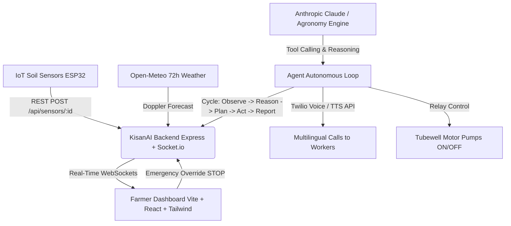

# 🌾 KisanAI – Autonomous Farm Operations System
### *Agentic AI × SDG Hackathon (SDG 2: Zero Hunger • SDG 12: Responsible Consumption • SDG 13: Climate Action)*

[](https://nodejs.org/)
[](https://react.dev/)
[](https://tailwindcss.com/)
[](LICENSE)

---

## 🎯 The Core Problem & Solution

Traditional farm management apps are **passive dashboards**—they display graphs and leave all decisions and labour coordination to the farmer.

**KisanAI flips this paradigm:**
A farmer registers their fields **ONCE**. From that moment onward, KisanAI runs the farm **autonomously**:
- 👁️ **OBSERVES**: Real-time Doppler weather forecasts (Open-Meteo), IoT soil moisture & temperature sensors, and crop growth stages.
- 🧠 **REASONS**: Evaluates strict agronomy rules (irrigation thresholds, rain forecast windows, foliar spray wind limits).
- 📋 **PLANS & REPLANS**: Coordinates tasks dynamically across all fields at once (e.g., reallocating a single sprayer contractor among 3 fields by urgency).
- ⚡ **ACTS AUTONOMOUSLY**: Starts tubewell pumps, cancels irrigation when rain is coming, schedules sprays, and places **multilingual voice phone calls to workers** (via Twilio / TTS in Hindi, Punjabi, Haryanvi, etc.).
- 📊 **REPORTS**: Maintains an activity stream (like a WhatsApp timeline), logs groundwater saved (Litres) and chemicals reduced (kg) towards UN Sustainable Development Goals.

---

## 🌍 UN Sustainable Development Goals (SDG) Alignment

| SDG Goal | Target Metric | KisanAI Autonomous Mechanism |
|---|---|---|
| **SDG 2: Zero Hunger** | **+18.5% Harvest Yield** | Early AI leaf pathology diagnosis (Leaf Doctor), optimal growth-stage moisture maintenance, and pest treatment alerts. |
| **SDG 12: Responsible Consumption** | **150+ kg Chemicals Prevented** | Strict foliar spray rules (never spray if wind >18 km/h or rain within 12h) prevent chemical drift and toxic runoff. |
| **SDG 13: Climate Action** | **812,500+ L Groundwater Preserved** | Predicts natural rainfall and automatically skips groundwater pumping, saving electricity (kWh) and reducing carbon emissions. |

---

## 🏗️ System Architecture



---

## 🚀 Key Features

1. **Autonomous 5-Stage Agent Loop (`OBSERVE → REASON → PLAN → ACT → REPORT`)**:
   - Runs every 30 minutes via `node-cron` or instantaneously upon sensor alerts.
   - Transparent AI explanations written in plain, human language.
2. **2-Minute Judge Demo Runner (`Run 2-Min Demo`)**:
   - Injects a sudden monsoon storm alert (92% rain probability).
   - Automatically stops active tubewell pump, cancels spray, reschedules cross-farm tasks, places an autonomous voice call to sprayer Suresh in Hindi, and displays "Plan changed because..." diff cards.
3. **Dynamic Crop Backgrounds**:
   - Atmospheric background photos smoothly transition based on selected crop (Wheat, Basmati Rice, Sugarcane, Cotton, Mustard, Potato).
4. **Interactive Leaf Doctor (Crop Disease Vision)**:
   - Diagnoses Yellow Rust, Bacterial Blight, Red Rot, and Alternaria Blight with confidence percentages and automatically books treatment sprays.
5. **Multilingual Voice Assistant**:
   - Web Speech API speech-to-text + speech synthesis in Hindi, Punjabi, and Indian accents.
6. **Mandi Commodity Rates & AI Trading Signals**:
   - MSP comparison, 7-day trend charts, and AI "HOLD / SELL NOW" recommendations.
7. **Government Schemes Finder**:
   - Matches farmer profile with PM-Kisan (₹6,000/yr), PMFBY Crop Insurance, and Per Drop More Crop (55% drip subsidy).
8. **Emergency Override Button**:
   - 1-click "EMERGENCY STOP" immediately halts all tubewell motors and pauses autonomous agent actions.
9. **Accessibility for Elderly Farmers**:
   - "Large Font" toggle mode and 11 language support (हिन्दी, English, ਪੰਜਾਬੀ, हरियाणवी, मराठी, ગુજરાતી, বাংলা, தமிழ், తెలుగు, ಕನ್ನಡ, اردو).

---

## 📦 Folder Structure

```
hackoween/
├── backend/
│   ├── src/
│   │   ├── agents/
│   │   │   ├── agentLoop.js        # OBSERVE -> REASON -> PLAN -> ACT -> REPORT loop
│   │   │   ├── llmEngine.js        # Anthropic Claude API + Agronomy Rule Engine
│   │   │   ├── tools.js            # start/stop/skip_irrigation, call_worker, replanning
│   │   │   └── voiceCaller.js      # Twilio Voice / TTS multilingual worker caller
│   │   ├── controllers/
│   │   │   ├── authController.js   # 4-step registration & JWT login
│   │   │   ├── farmController.js   # Fields, motors, sensor telemetry
│   │   │   ├── agentController.js  # Agent cycle, feed, override & judge demo
│   │   │   ├── sensorController.js # REST endpoint POST /api/sensors/:fieldId
│   │   │   ├── diseaseController.js# Leaf pathogen scanner & treatment scheduling
│   │   │   ├── mandiController.js  # Mandi rates & sell signals
│   │   │   ├── schemesController.js# Govt agricultural schemes
│   │   │   └── financesController.js# Profit/loss & SDG impact metrics
│   │   ├── database/
│   │   │   └── db.js               # Dual Mongo / In-Memory resilient fallback store
│   │   ├── models/                 # Farmer, Farm, Worker, Task, SensorLog, DecisionLog, CallLog
│   │   ├── routes/                 # Express API routes
│   │   ├── seed/
│   │   │   └── seedData.js         # 3 sample farms (Wheat, Rice, Sugarcane) + workers
│   │   ├── services/
│   │   │   ├── weatherService.js   # Free Open-Meteo live weather & 72h forecast
│   │   │   ├── sensorSimulator.js  # IoT soil moisture & temperature generator
│   │   │   └── socketService.js    # Real-time WebSockets
│   │   └── server.js               # Entry point
│   ├── .env.example
│   └── package.json
├── frontend/
│   ├── src/
│   │   ├── components/             # Navbar, FarmCard, DetailModal, DemoRunner, Voice, etc.
│   │   ├── context/                # AuthContext, FarmContext, SocketContext
│   │   ├── i18n/                   # 11 Indian languages & dialects
│   │   ├── utils/                  # Crop themes & background imagery
│   │   ├── App.jsx                 # Dashboard assembly
│   │   └── main.jsx
│   ├── tailwind.config.js
│   ├── index.html
│   └── package.json
└── README.md
```

---

## ⚡ Quick Start Guide

### Prerequisites
- Node.js v18+ (tested on v24)
- npm v9+

### 1. Clone & Install Dependencies
```bash
# In backend
cd backend
npm install

# In frontend
cd ../frontend
npm install
```

### 2. Configure Environment
```bash
# In backend/.env
PORT=5000
MONGODB_URI=mongodb://127.0.0.1:27017/kisanai
JWT_SECRET=kisanai_hackathon_super_secret_jwt_key_2026
MOCK_PHONE_CALLS=true
# Optional: ANTHROPIC_API_KEY=your_key (fallback agronomy engine works out of the box)
```
*(Note: If MongoDB is not installed locally, KisanAI automatically activates its built-in resilient In-Memory Smart Store so it works out-of-the-box on any machine!)*

### 3. Run the Application
**Terminal 1 (Backend):**
```bash
cd backend
npm start
```
*Backend runs at `http://localhost:5000` (auto-seeds 3 sample farms & starts IoT generator).*

**Terminal 2 (Frontend):**
```bash
cd frontend
npm run dev
```
*Frontend runs at `http://localhost:5173`.*

---

## 🧪 Testing the 2-Minute Judge Demo

1. Open **`http://localhost:5173`** in your browser.
2. Click the glowing **`⚡ Run 2-Min Demo`** button in the top navbar.
3. Click **`Trigger Monsoon Event Now ⚡`**.
4. Observe the synchronized reactions:
   - Doppler radar satellite storm warning (92% rain forecast).
   - Running tubewell pump on Wheat plot stops immediately.
   - Planned irrigation on Rice and Sugarcane skipped, saving 140,000L water.
   - Tomorrow's urea spray rescheduled by 2 days.
   - Autonomous simulated voice call placed to sprayer Suresh in Hindi with audio speech playback!
   - Dynamic "Plan changed because..." Before vs After cards populated on dashboard.

---

## 📜 License
MIT License. Built with ❤️ for Indian farmers and the **Agentic AI × SDG Hackathon**.
